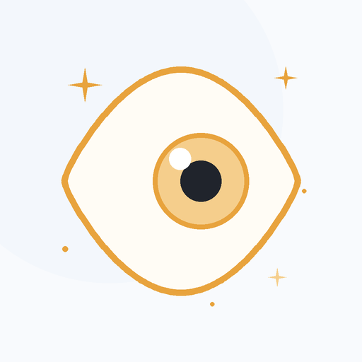

# 余光 · astrbot_plugin_glance

<p align="center"></p>

偶尔看一眼屏幕，有变化才说话。

不是监控，也不是录屏。它每隔一段时间掷一次骰子，命中才截一张图，交给本机的视觉模型读懂画面；说不说、什么时候说，由你选的那一档决定。

## 四档

| mode | 采样 | 推送 | 工具 | 适合 |
|---|---|---|---|---|
| `silent` | 有 | 无 | 无 | 只记账，事后自己查 |
| `push` | 有 | 变化时一句 | 无 | 想让它偶尔搭话 |
| `look` | 无 | 无 | 有 | 只在被问到时看一眼 |
| `both` | 有 | 有 | 有 | 两样都要 |

默认 `silent`。装上不读文档，也不会开始截屏或说话。

`look` / `both` 会挂一个 `look_at_screen` 工具：用户问“我在干嘛”“这关怎么过”“屏幕上是什么”时，模型自己决定要不要看。一次调用三到十秒。

## 为什么默认关

截屏是敏感动作。装上就开跑，第一印象是“被盯着”；默认关着，第一印象是“它懂分寸”。

开启需要两步：选一个 `mode`，再填 `target_umo`（`look` 档不需要后者，它不推送）。

## 配置

| 键 | 默认 | 说明 |
|---|---|---|
| `mode` | `silent` | 工作模式，见上表 |
| `target_umo` | 空 | 推送到哪个会话，空则不采样 |
| `sample_seconds` | `300` | 每隔多久掷一次骰子 |
| `prob_percent` | `20` | 命中概率，与上一项相乘就是实际看图频率 |
| `model` | `qwen3-vl:4b` | Ollama 里的多模态模型 |
| `ollama_url` | `http://127.0.0.1:11434` | 本地 Ollama 地址 |
| `shot_dir` / `log_path` / `status_path` / `state_path` | 插件数据目录 | 截图、日志、状态、最近一次所见 |

## 模型输出

视觉模型被要求只输出一个 JSON：

```json
{"app": "程序或页面", "doing": "大概在做什么", "texts": ["画面上的文字"], "confidence": 0.8}
```

插件再拼一句人话摘要用于推送；`eye_state.json` 保存最近一次所见，供外部读取。模型不按格式作答时，整段文本会退化成摘要，不会崩。

## 运行方式

- 在 AstrBot 进程内跑，不起外部进程、不挂计划任务；AstrBot 关掉就随之结束。
- 识图是同步 HTTP，丢进线程池，不阻塞事件循环。
- 日志按 2MB 轮转，截图最多留 200 张。
- `/eye` 查看当前档位、轮次与最近状态。

## 依赖

- Windows（`PIL.ImageGrab`）
- 本地 Ollama 与一个多模态模型，默认 `qwen3-vl:4b`
- AstrBot 4.29 及以上

## 隐私

图片只发往本机 Ollama，不出网。除了你配置的那个会话，它不会把画面发给任何地方。

## License

MIT
